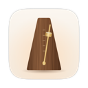
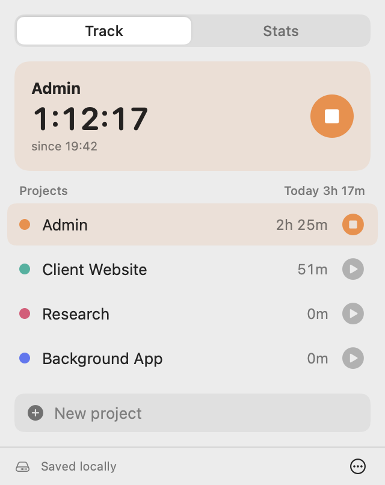
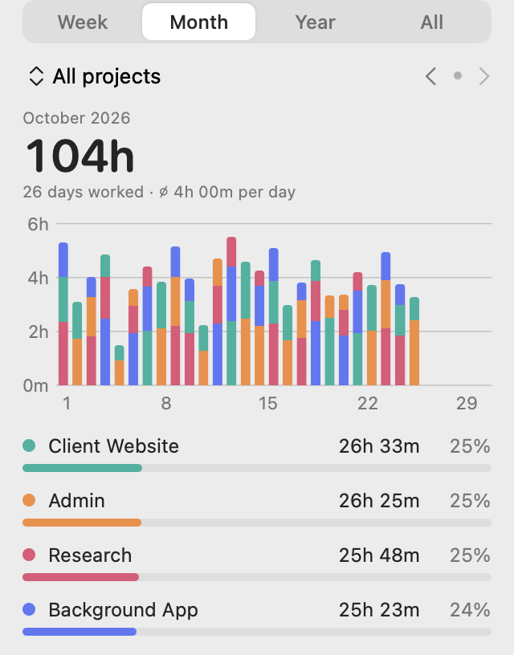

# Sempre

A small time tracker that lives in the macOS menu bar.

<p>
  <picture>
    <source media="(prefers-color-scheme: dark)" srcset="docs/track-dark.png">
    
  </picture>
  <picture>
    <source media="(prefers-color-scheme: dark)" srcset="docs/month-dark.png">
    
  </picture>
</p>

- Add projects (and optional subprojects), click to start and stop
- Animated metronome in the menu bar while a timer runs, with `h:mm` and the odd nudge
- Stats by week, month, year or all time, per project, with days worked
- Edit, add or delete entries; add breaks as a length or an exact time
- Syncs between Macs through iCloud Drive (`iCloud Drive/Sempre/sempre.json`)
- Imports projects, tasks and time records from Tyme 2
- No third-party dependencies

Requires macOS 14 or later (Apple Silicon or Intel).

## Build

```sh
./build.sh
```

Builds a universal `build/Sempre.app`, packs `build/Sempre-<version>.zip` and installs the app to `~/Applications`.
See the top of `build.sh` for Developer ID signing and notarization. No signing material lives in this repo.

## Test

```sh
./test.sh
```

Runs the Swift Testing suite in `Tests/SempreCoreTests`. It works with Xcode or with just the Command Line Tools.
The Tyme tests build a small fake Tyme database on the fly; no real Tyme data is involved.

## Structure

- `Sources/SempreCore`: data model, storage and sync (`Store`), formatting, the Tyme 2 importer. No UI.
- `Sources/Sempre`: the menu bar app (SwiftUI), the animated menu bar icon and developer flags.
- `Tests/SempreCoreTests`: tests for everything in `SempreCore`.
- `Resources/AppIcon.icns`: the app icon, drawn by `scripts/make-icon.swift`; run `scripts/make-icon.sh` after changing it.

## Install from the zip

Unzip and move `Sempre.app` to Applications. Unless the build was signed with a Developer ID,
macOS blocks the first launch: right-click the app › Open, or run

```sh
xattr -dr com.apple.quarantine /Applications/Sempre.app
```

## Import from Tyme 2

Menu `⋯` › Import from Tyme 2…, then choose Tyme's
`~/Library/Containers/de.lgerckens.Tyme2/Data/Library/Application Support` folder (or a copy of it).
Importing again only adds what's new.

## Developer flags

- `Sempre --import-test <path>` dry-runs the Tyme importer and prints totals per project
- `Sempre --snapshot <dir> [--real]` renders the UI to PNGs (light and dark), with demo data or (read-only) your own.
  The screenshots in `docs/` come from this, with demo data.

## License

MIT, see [LICENSE](LICENSE).
